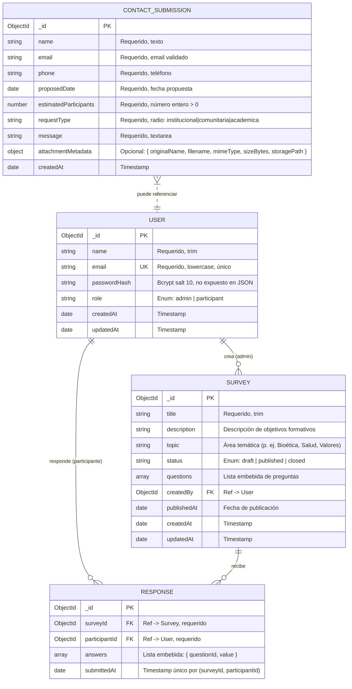

# DIAGRAMA DE ESTRUCTURA DE LA BASE DE DATOS NOSQL (MONGODB)

**Proyecto:** JGH Encuestas — Sistema de Encuestas Formativas  
**Cátedra Libre Dr. José Gregorio Hernández · Universidad Valle del Momboy**  
**Motor:** MongoDB con modelado Mongoose ODM  

---

## 1. DIAGRAMA ENTIDAD-RELACIÓN / DOCUMENTAL (MERMAID)

---

## 2. ÍNDICES Y RESTRICCIONES DE INTEGRIDAD
1. **Colección `users`:**
   - Índice único: `{ email: 1 }` (garantiza que no existan cuentas duplicadas).
2. **Colección `surveys`:**
   - Índice compuesto: `{ status: 1, createdAt: -1 }` (optimiza la consulta pública de encuestas publicadas).
   - Índice de búsqueda de texto: `{ title: "text", topic: "text", description: "text" }`.
3. **Colección `responses` (Módulo reservado):**
   - Índice compuesto único: `{ surveyId: 1, participantId: 1 }` con `unique: true` (garantiza en el nivel de motor que un participante no pueda responder dos veces a la misma encuesta).
4. **Colección `contactSubmissions`:**
   - Índice temporal: `{ createdAt: -1 }` (consulta cronológica para administradores).
